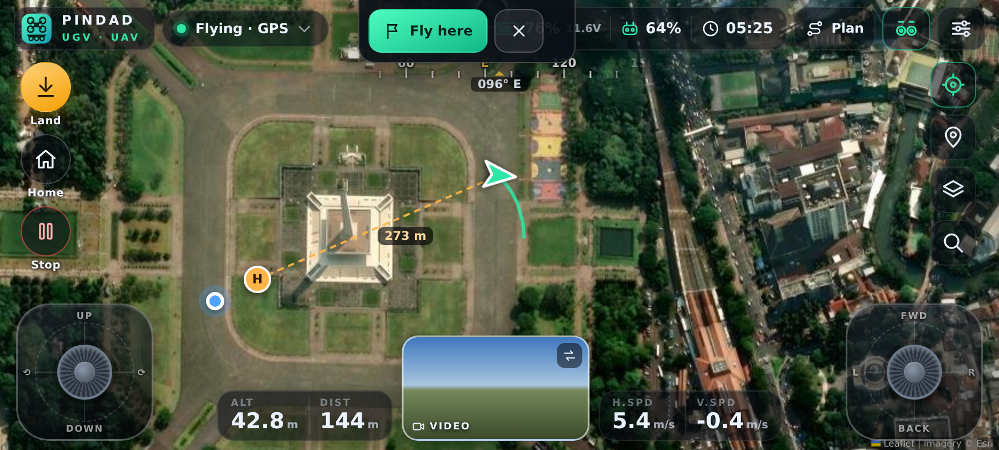
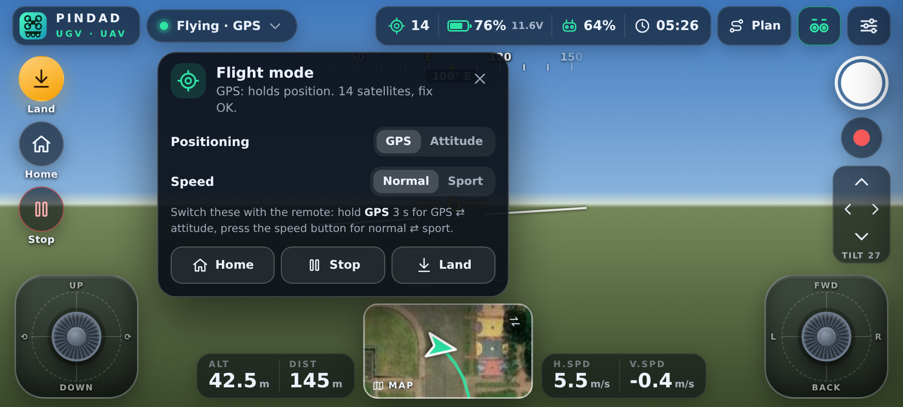

# Reverse-Engineer-Drone-SJRC-F22S2

An open ground-control app for the **SJRC F22 S2 PRO+** GPS drone, built by reverse engineering how
the official app talks to the drone's remote. It runs on **Android** (phone plugged into the remote)
and on **Raspberry Pi 5 / Linux** (Python + Qt, with RTSP video streaming), and it documents the
protocol so the drone can join other systems (UGVs, swarms, QGroundControl).

<p align="center">
  
  
</p>

## Download

**[⬇ Pindad-UGV-UAV-1.2.apk](releases/Pindad-UGV-UAV-1.2.apk)** (Android 8.0+, 165 KB)

1. Download the APK on the phone and open it (allow installing from your browser or file manager).
2. Open **Pindad UGV - UAV** *first*, then plug the drone's remote into the phone, then tap **Connect**.
3. If the official SJ F PRO app is installed, disable it (Settings › Apps) so it does not grab the remote.

## Features

| | |
| --- | --- |
| **Live video** | hardware-decoded H.265 / H.264 from the drone camera, full screen |
| **Flight** | take off (starts the motors first), land, return to home, stop automatic flight, all with slide-to-confirm |
| **Virtual sticks** | two thumb sticks like a normal remote (Mode 2, Mode 1 in Settings), centre = hold altitude |
| **Map** | satellite / street map, drone + home + your position, flight trail, tap a point to *Fly here*, place search |
| **Missions** | waypoint planner: tap to add, drag to move, altitude / speed / hover time, upload with per-point confirmation |
| **Camera** | photo and video on the drone's SD card **and** in the phone's Gallery (`Pictures/` and `Movies/Pindad UGV-UAV`), gimbal tilt |
| **Flight display** | horizon, heading tape, altitude, distance, speeds, GPS, drone and remote battery, warnings |
| **UGV / PC link** | TCP port 9000: a computer on the same network receives all frames and can send commands |

<p align="center">
  
  
  
</p>

## Raspberry Pi 5 + Starlink

[`raspi/`](raspi/) is the same app in Python + Qt for a Raspberry Pi 5. The remote plugs into the Pi,
which poses as the Android phone (USB gadget). The Pi streams the drone's video over **RTSP** without
re-encoding (`rtsp://PI:8554/drone`) and telemetry over **MAVLink** for QGroundControl, through
Ethernet to a Starlink router. It can run headless as a relay. See [raspi/README.md](raspi/README.md).

## Repository

| Folder | |
| --- | --- |
| [`android/`](android/) | Android Studio project of the app (Java core + web interface in `assets/ui`) |
| [`raspi/`](raspi/) | Raspberry Pi / Linux ground station (Python, Qt, GStreamer RTSP, MAVLink) |
| [`docs/PROTOCOL.md`](docs/PROTOCOL.md) | the decoded protocol: USB frames, every message and bit, video, behaviour, test results |
| [`tools/`](tools/) | Python tools: talk to the drone from a PC through the app, test features, analyse captures, build the APK without Android Studio |
| [`releases/`](releases/) | ready-to-install APK |

## How it works

```
 phone / Raspberry Pi ──USB (Android Open Accessory)──► remote ──radio──► drone
```

The remote is a USB host that talks to an Android device in accessory mode. Every message is
wrapped in an `FF 56 53` frame: control and extend messages every 100 ms carry the buttons
(1-second pulses), and the remote returns a telemetry stream (attitude, GPS, battery, modes) and the
H.265 video. All of it is in [docs/PROTOCOL.md](docs/PROTOCOL.md).

## Building

- **Android Studio:** open `android/`, build normally (Gradle 8.9, AGP 8.7.3, no library dependencies).
- **Without Android Studio** (ARM64 Linux, where aapt2 is not available): `tools/build_apk.sh`
  (javac, d8, a small manifest converter and resources.arsc writer); see the script header for the
  toolchain variables.
- Interface screenshots: `android/tools/ui_screenshots.sh` (headless Chrome, demo data).

## Testing from a PC

With the app connected to the remote and **PC control** on (Settings), from this folder:

```bash
python3 tools/find_bridge.py                       # find the phone on the network
python3 tools/watch.py PHONE_IP                    # live telemetry, listen only
python3 tools/feature_test.py PHONE_IP             # test the features (motors stay off)
python3 tools/feature_test.py PHONE_IP --props-removed   # also take off and land
```

## Safety

- **Remove the propellers** for any test that can start the motors. Fly outdoors, within sight, with
  the remote in your hands, following your local drone rules.
- The app never sends the remote's power or firmware-upgrade frames or calibration commands.
- Unplug the remote before closing or updating the app (on some phones a pending USB read crashes the phone).

## Disclaimer

Independent project, not affiliated with or endorsed by SJRC. It contains no code or files from the
official app; the protocol was documented for interoperability. Use at your own risk.

## License

[Apache License 2.0](LICENSE)
