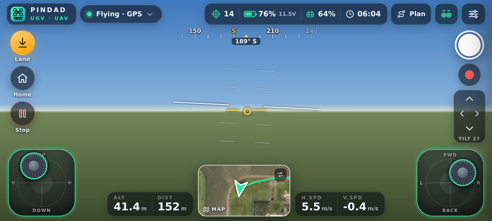
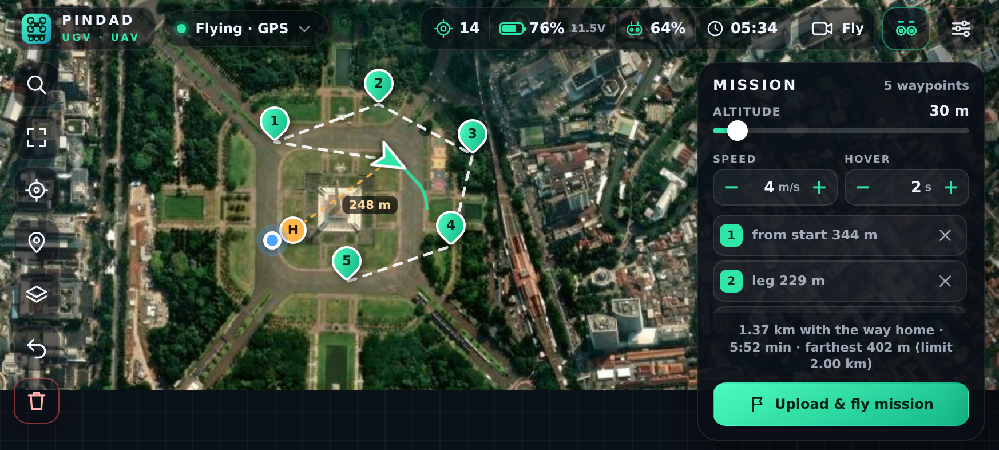
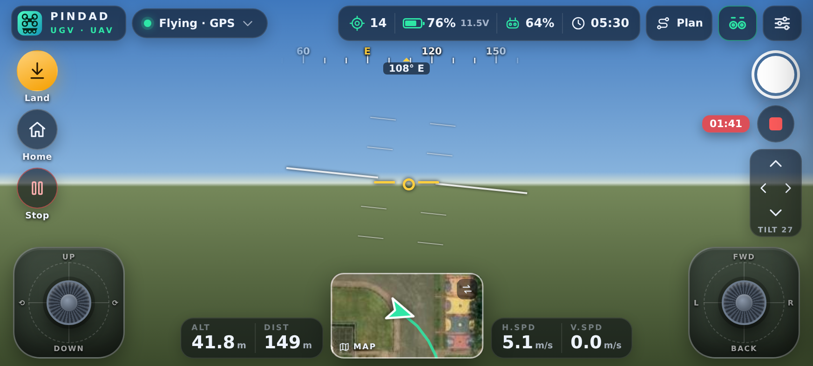
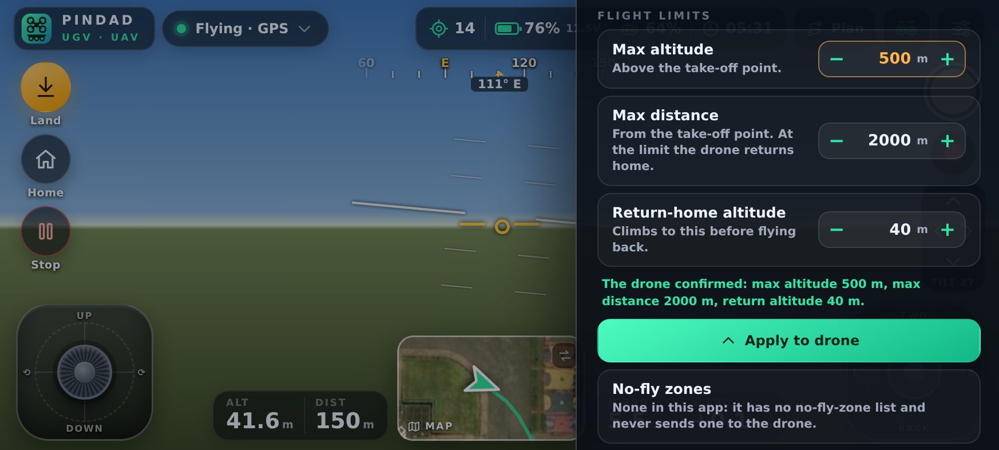
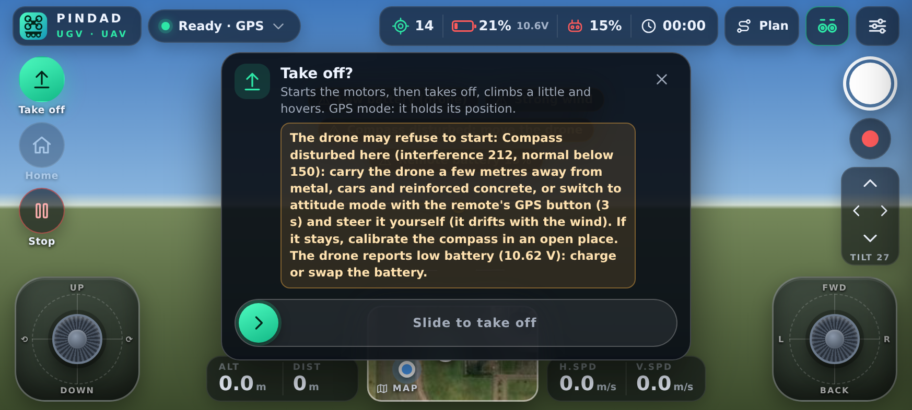
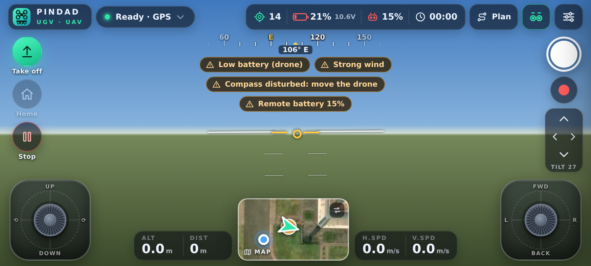
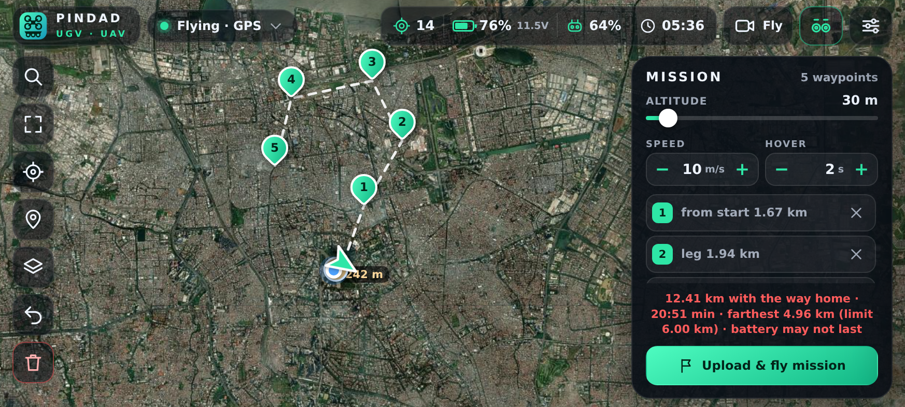
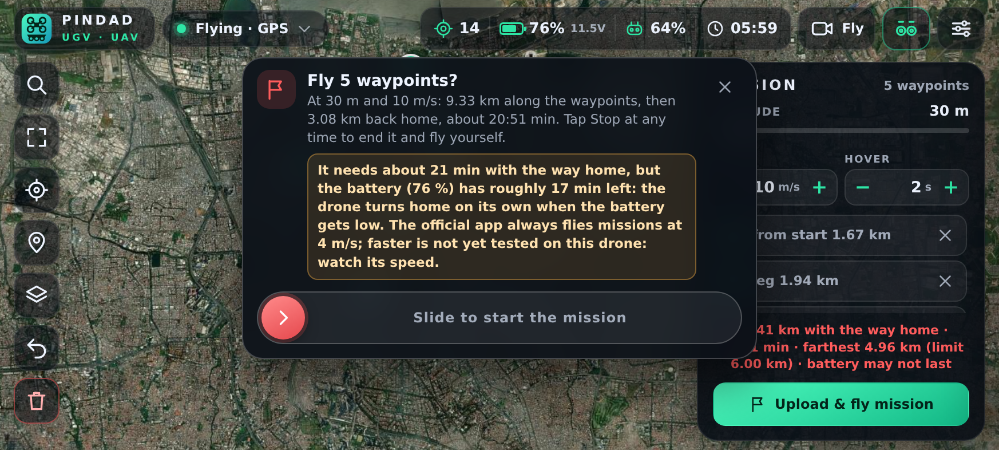

# Reverse-Engineer-Drone-SJRC-F22S2

An open ground-control app for the **SJRC F22 S2 PRO+** GPS drone, built by reverse engineering how
the official app talks to the drone's remote. It runs on **Android** (phone plugged into the remote)
and on the **NVIDIA DGX Spark / Linux** (Python + Qt, with RTSP video streaming), and it documents the
protocol so the drone can join other systems (UGVs, swarms, QGroundControl).

<p align="center">
  
  
</p>

## Download

**[⬇ Pindad-UGV-UAV-1.4.apk](releases/Pindad-UGV-UAV-1.4.apk)** (Android 8.0+, 177 KB)

1. Download the APK on the phone and open it (allow installing from your browser or file manager).
2. Open **Pindad UGV - UAV** *first*, then plug the drone's remote into the phone, then tap **Connect**.
3. If the official SJ F PRO app is installed, disable it (Settings › Apps) so it does not grab the remote.

To update, unplug the remote first, then install the new APK over the old one.

### What's new in 1.4

- **Longer missions.** Waypoints can be up to 10 km from home, instead of 1.5 km. They must stay inside
  the drone's max distance, so raise it first in Settings › Flight limits (now 20–10000 m). The drone
  returns home when it reaches that limit, and when it loses the remote: the remote reaches about 6 km in
  open country.
- **Mission planner** shows the whole trip with the way home, its flight time and how far out it goes,
  and warns when the battery may not last. Distances are measured from home, like the drone does.
- At most **16 waypoints**, like the drone's manual and the official app (more were never tried).
- When the compass blocks the take-off, the app also suggests attitude mode (remote's GPS button, 3 s).
- Mission height stays at most **409 m**: the waypoint message has no room for more.

### Also new since 1.2 (version 1.3 was not released separately)

- **Steady battery percentage.** The drone's own number is its live voltage, which sags while the motors
  pull current. The app keeps the resting value at take-off, adds back the sag it measures once the drone
  hovers, and never lets the number rise in flight.
- **Says why the drone will not start.** If the motors do not start, the app shows the drone's reasons:
  compass disturbed (move the drone a few metres away from metal or reinforced concrete), no GPS fix,
  low battery, a calibration running, or a no-fly block. Version 1.2 wrongly blamed GPS.
- **Flight limits** in Settings: max altitude (10–5000 m), max distance (20–6000 m) and return-home
  altitude, sent to the drone, confirmed by its answer, and re-sent after every connection.
- **No-fly zones:** the app has none. A take-off block left by the official app can be cleared in Settings.

## Features

| | |
| --- | --- |
| **Live video** | hardware-decoded H.265 / H.264 from the drone camera, full screen |
| **Flight** | take off (starts the motors first), land, return to home, stop automatic flight, all with slide-to-confirm |
| **Virtual sticks** | two thumb sticks like a normal remote (Mode 2, Mode 1 in Settings), centre = hold altitude |
| **Map** | satellite / street map, drone + home + your position, flight trail, tap a point to *Fly here*, place search |
| **Missions** | waypoint planner: up to 16 points and 10 km from home, tap to add, drag to move, altitude / speed / hover time, trip time with the way home and a battery check, upload with per-point confirmation |
| **Camera** | photo and video on the drone's SD card **and** in the phone's Gallery (`Pictures/` and `Movies/Pindad UGV-UAV`), gimbal tilt |
| **Flight display** | horizon, heading tape, altitude, distance, speeds, GPS, drone and remote battery, warnings |
| **Battery** | steady percentage with the voltage sag compensated, voltage, the drone's own low-battery levels |
| **Take-off checks** | before take-off and when the motors do not start: compass, GPS, battery, calibration and no-fly flags in plain words |
| **Flight limits** | max altitude (to 5000 m), max distance (to 10 km), return-home altitude; the drone's answer is shown |
| **UGV / PC link** | TCP port 9000: a computer on the same network receives all frames and can send commands |

<p align="center">
  
  
  
</p>
<p align="center">
  
  
  
</p>
<p align="center">
  
  
</p>

## DGX Spark + Starlink

[`dgx-spark/`](dgx-spark/) is the same app in Python + Qt for the **NVIDIA DGX Spark** (any Linux
computer works). It shows the cockpit, streams the drone's video over **RTSP** without re-encoding
(`rtsp://DGX:8554/drone`) and telemetry over **MAVLink** for QGroundControl, through Ethernet to a
Starlink router, and can run headless as a relay.

The DGX Spark's USB ports are host-only, like the remote's, so a small **USB bridge** plays the phone:
a Raspberry Pi in USB gadget mode ([`bridge/`](bridge/)) or the Android app itself.

```
 remote ──USB──► bridge (Pi or phone) ──Ethernet──► DGX Spark ──► Starlink ──► viewers / QGroundControl
```

## Repository

| Folder | |
| --- | --- |
| [`android/`](android/) | Android Studio project of the app (Java core + web interface in `assets/ui`) |
| [`dgx-spark/`](dgx-spark/) | ground station for the DGX Spark / Linux (Python, Qt, GStreamer RTSP, MAVLink) |
| [`bridge/`](bridge/) | USB bridge for the remote (Raspberry Pi in USB gadget mode) |
| [`docs/PROTOCOL.md`](docs/PROTOCOL.md) | the decoded protocol: USB frames, every message and bit, video, behaviour, test results |
| [`tools/`](tools/) | Python tools: talk to the drone from a PC through the app, test features, analyse captures, build the APK without Android Studio |
| [`releases/`](releases/) | ready-to-install APK |

## How it works

```
 phone or USB bridge ──USB (Android Open Accessory)──► remote ──radio──► drone
```

The remote is a USB host that talks to an Android device in accessory mode. Every message is
wrapped in an `FF 56 53` frame: control and extend messages every 100 ms carry the buttons
(1-second pulses), and the remote returns a telemetry stream (attitude, GPS, battery, modes) and the
H.265 video. All of it is in [docs/PROTOCOL.md](docs/PROTOCOL.md).

## Building

- **Android Studio:** open `android/`, build normally (Gradle 8.9, AGP 8.7.3, no library dependencies).
- **Without Android Studio** (ARM64 Linux, where aapt2 is not available): `tools/build_apk.sh`
  (javac, d8, a small manifest converter and resources.arsc writer); see the script header for the
  toolchain variables.
- Interface screenshots: `android/tools/ui_screenshots.sh` (headless Chrome, demo data).

## Testing from a PC

With the app connected to the remote and **PC control** on (Settings), from this folder:

```bash
python3 tools/find_bridge.py                       # find the phone on the network
python3 tools/watch.py PHONE_IP                    # live telemetry, listen only
python3 tools/feature_test.py PHONE_IP             # test the features (motors stay off)
python3 tools/feature_test.py PHONE_IP --props-removed   # also take off and land
```

## Safety

- **Remove the propellers** for any test that can start the motors. Fly outdoors, within sight, with
  the remote in your hands, following your local drone rules.
- The app never sends the remote's power or firmware-upgrade frames or calibration commands.
- Flight limits above 120 m, missions far out and clearing a no-fly block are your decision: check your
  local rules (most countries require keeping the drone within sight), stay away from airports, and keep
  enough battery to come back.
- Unplug the remote before closing or updating the app (on some phones a pending USB read crashes the phone).

## Disclaimer

Independent project, not affiliated with or endorsed by SJRC. It contains no code or files from the
official app; the protocol was documented for interoperability. Use at your own risk.

## License

[Apache License 2.0](LICENSE)
